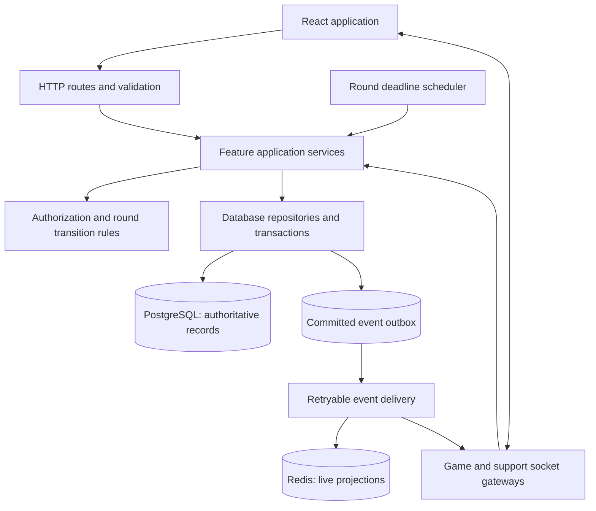

# Karera architecture recommendations and improvement approach

Prepared on 2026-10-11 from the current frontend and sibling backend source review.
This document proposes a target architecture; it does not describe changes already implemented.
The archive service and separate game-site repository have not been audited here.

Related documents:

- [Current project flow and API reference](PROJECT_FLOW.md)
- [Feature and API completion checklist](COMPLETION_CHECKLIST.md)

## 1. Recommended direction

Keep React/Vite, Fastify, PostgreSQL, and Redis. Organize the backend as a
**modular monolith**: one application with clear feature boundaries and a shared
transactional database. Start with one backend process owning the live studios.
Extract shared business services so HTTP and WebSocket transports call the same
operations directly. Make PostgreSQL authoritative for accepted bets, balances,
round results, and settlement; make Redis a recoverable live-data projection.

This is an architectural recommendation based on the present code size and tightly
connected game/wallet operations. Splitting those operations into independently
deployed services now would introduce distributed consistency work before existing
round reliability problems are resolved. Reconsider that choice when measurements,
deployment needs, or team ownership justify it.

Local development should continue to run without Docker: Node.js for the apps,
Windows PostgreSQL, and Redis in WSL. Hosting and development tooling should remain
independent from the business logic.

## 2. Target system structure



The outbox is a proposed table containing events written in the same transaction
as a successful database operation. A delivery loop retries undelivered events.
This bridges a committed bet or payout to Redis and socket notifications without
pretending that PostgreSQL and Redis share one transaction. Delivery may repeat;
consumers must apply events idempotently using an event ID/version.

### Ownership of data

| Data | Authoritative owner | Redis/frontend role |
| --- | --- | --- |
| Users, active login sessions, permissions | PostgreSQL/auth module | Cache only where revocation behavior is defined |
| Games, rooms, studios, configured streams | PostgreSQL/game configuration | Frontend selects from returned configuration |
| Round state, deadline, winning result, settlement status | PostgreSQL/game module | Redis caches the current view; frontend displays it |
| Accepted bets, wallet holds, balances, commissions | PostgreSQL/wallet and game services | Redis aggregates pools; frontend displays acknowledged values |
| Connected sockets and delivery buffers | Socket gateway | Process-local and disposable |
| Online presence | Redis with expiry, or local state initially | Informational, not financial truth |
| Support tickets, sessions and messages | PostgreSQL/support module | Sockets deliver new messages; reads restore history |

Do not accept a frontend's balance, role, odds, or payout amount as authoritative.

## 3. Suggested backend layout

The following is a proposed structure. Migrate one feature at a time; do not move
every file before proving that behavior is preserved.

```text
src/
  main.ts                         # Process startup and shutdown
  app.ts                          # Build an app with injectable dependencies
  config/                         # Validated environment configuration
  infrastructure/
    database/                     # Pool, migrations, transaction helpers
    redis/                        # Clients, key conventions, recovery
    events/                       # Outbox storage and delivery loop
    uploads/                      # Storage and file URL handling
  shared/
    auth/                         # Session validation and permission helpers
    errors/                       # Stable error codes and response mapping
    contracts/                    # HTTP and WebSocket schemas
  modules/
    accounts/
    game/
      routes.ts                   # HTTP adapter
      socket-handlers.ts          # WebSocket adapter
      service.ts                  # Start round, accept bet, declare result
      transitions.ts              # Allowed states and commands
      repository.ts               # Persistent reads/writes
      scheduler.ts                # Deadline-based transitions
    wallet/                       # Holds, debits, credits, reconciliation
    payments/                     # Provider adapters and callback processing
    support/                      # Tickets and chat
    referrals/                    # Codes, networks and commissions
    administration/               # Authorized operational workflows
```

Responsibilities:

- Routes validate inputs, authenticate, call services, and map responses.
- Services enforce business rules and define transaction boundaries.
- Repositories receive the transaction context; they do not silently open separate transactions.
- Socket gateways validate envelopes, identify users/studios, call services, and deliver events.
- Provider adapters isolate SMS, verification, and payment-provider request/response formats.
- Process startup owns timers, workers, pools, and graceful shutdown.

The current WebSocket code uses `fastify.inject()` to reuse route handlers.
Replace that with a shared `GameService.acceptBet()` or `GameService.settleRound()`
called by both adapters. Keep route-level tests for the public HTTP contract,
and test the financial behavior at the service boundary.

## 4. Game and wallet approach

### Explicit round transitions

Use one transition policy instead of state checks spread across moderator,
broadcast, and player handlers. Persist a round's state and version. Model
settlement separately from display states so declaring a winner cannot be
mistaken for paying the round.

Proposed lifecycle:

```text
Created → BettingOpen → BettingClosed → Rolling → ResultDeclared
        → Settling → Settled
Eligible unsettled states → Cancelling → Cancelled
```

`LastCall` and `Closing` can be presentation phases derived from the betting
deadline. Define exactly which states permit cancellation and who may request it.
A result correction after settlement needs a separate audited correction policy;
it must not silently overwrite an already paid result.

### Reliable bet acceptance

1. Validate the signed token, active session, permitted action, studio, round, choice, and amount.
2. Begin a PostgreSQL transaction and lock the current round and wallet in a consistent order.
3. Recheck the persisted round state/deadline and available funds inside that transaction.
4. Enforce the agreed duplicate-bet rule with a database constraint and request idempotency.
5. Insert the bet, reserve the stake, and write a committed event/outbox row.
6. Commit before acknowledging acceptance. Return the accepted bet and available balance.
7. Apply the event to Redis aggregates and notify clients with retry/idempotency handling.

When projecting events is delayed, return the authoritative accepted result and
resynchronize the UI; do not repeat a financially successful bet just because
a live-cache update failed.

### Reliable settlement

Lock the round, reject an incompatible state, and make settlement idempotent.
Calculate the payout from persisted accepted bets and a server-owned frozen
result/odds snapshot. Process wallet holds, stakes, winnings, commissions, and
settlement records together. Persist a successful settlement and its events before
broadcasting. For a failed transaction, preserve the round for retry or intervention.

For initially modest rounds, a single transaction is the simplest boundary. If
measurements later require batching, use an explicit resumable settlement operation
with per-item uniqueness and keep the round unavailable until it is fully reconciled.

### Money and database safeguards

Use a documented fixed decimal scale and rounding policy throughout the service.
Keep precise PostgreSQL `numeric` values and avoid converting monetary calculations
to JavaScript floating-point arithmetic. PostgreSQL documents `numeric` as an exact
numeric type suitable for monetary calculations. [PostgreSQL numeric types](https://www.postgresql.org/docs/current/datatype-numeric.html)

Acquire locks inside the transaction that checks funds and updates the wallet;
the current bet handler's wallet read/lock occurs before its transaction.
PostgreSQL row locks are released at transaction end, so lock placement matters.
Use a consistent lock order and bounded retries for retryable conflicts.
[PostgreSQL explicit locking](https://www.postgresql.org/docs/current/explicit-locking.html)

Review/add constraints only after inspecting existing data and schema:

- One accepted bet per round/user/choice if that remains the product rule.
- One settlement operation/result per round and one application per settlement item.
- Unique provider event IDs and request idempotency keys scoped to the user/operation.
- Valid positive stakes and valid wallet-hold bounds, with an explicit overdraft policy.
- Consistent foreign keys and indexes for actual session, user, and history reads.

Record financial movements in an append-only ledger with links to the originating
bet, payout, payment, or transfer. Treat balances as a maintained summary and provide
reconciliation. Administrative corrections should create compensating entries rather
than erase historical movements.

## 5. WebSocket architecture

Use separate game and support connection managers, with different typed maps.
Resolve the studio from a validated subscription/connection path. Authenticate
every new connection and restrict messages by role and active session.

Keep the existing protocol working during migration. A future versioned envelope
can add `requestId`, `eventId`, `studioNo`, `roundId`, `roundVersion`, and timestamps.
Replies should distinguish command accepted/rejected from subsequent broadcasts,
using stable error codes. These are proposed fields, not current guarantees.

Connection sequence:

```text
Connect → Authenticate → Subscribe/select studio → Snapshot
        → Receive ordered/versioned events → Resnapshot if a gap is detected
Disconnect → Retry with backoff → Authenticate again → Snapshot again
```

Handle intentional closure separately from unexpected disconnection. Add heartbeat,
message-size limits, command rate limits, bounded queues, and slow-client handling.
Do not replay queued bet/payout commands blindly after reconnect; correlate them
with request IDs and check their persisted outcome first.

Use a persisted `closesAt` timestamp and derive remaining seconds from that deadline.
Intervals should refresh the display and trigger guarded transitions, not define
elapsed game time. Node timers do not guarantee exact callback timing.
[Node.js timer documentation](https://nodejs.org/api/timers.html)

Enforce transitions independently of connected clients. Process one state-changing
command per studio/round at a time, backed by database state/version checks.

## 6. Frontend organization and data flow

Keep role-specific pages, but group API contracts, hooks, and state by feature:

```text
src/
  app/                            # Router, providers, layouts
  features/
    auth/
    game/                         # API, socket adapter, reducer, hooks, UI
    wallet/
    payments/
    support/
    game-site/
    administration/
  shared/
    api/                          # HTTP client and normalized errors
    contracts/                    # Types derived from agreed schemas
    ui/                           # Reusable components
```

Distinguish server data from presentation state. Keep balances, accepted bets,
session records, and chat history synchronized through reads/acknowledged events.
Use Zustand for selections, drawers, display preferences, and connection state.
Centralize game event handling in one reducer so player/moderator components do
not each invent interpretations of the same message.

Preserve structured errors instead of rejecting only an error string in Axios.
Callers need status, code, message, request ID, and retryability. Make loading,
pending, accepted, failed, and reconnecting states visible where actions depend on them.
Do not display bet or payment success before the authoritative acknowledgement.

Define shared HTTP/WebSocket contracts and validate messages at runtime. Types
alone cannot validate incoming JSON. Keep Swagger schemas, frontend types, and
actual handler responses aligned. A shared contract package or generated artifacts
can work with the existing separate repositories; a monorepo is optional.

## 7. Verified problems to fix before optimization

P0 means core correctness; P1 means reliability/feature completion. These findings
come from the source review, not from an assertion that every failure was reproduced.

| Priority | Current problem | Recommended fix | Verification |
| --- | --- | --- | --- |
| P0 | `/win` accepts caller-provided winnings; settlement sequencing/retry behavior is weak | Compute from server-owned records and persist idempotent settlement | Retry and concurrent payout attempts produce one financial result |
| P0 | Redis round state is flushed while PostgreSQL bets remain | Dedicated key ownership and persisted recovery/void policy | Restart with accepted bets leaves no unexplained holds |
| P0 | Wallet checks/locks and financial updates have inconsistent boundaries | One transaction with locked/conditional updates and constraints | Concurrent bets cannot overspend available funds |
| P0 | Async `isGameSessionValid()` is used without `await` | Await validation before winner/payout mutation | Invalid session cannot progress |
| P0 | Payout handler can advance/broadcast after errors; offline winners assume sockets | Return on failure and separate settlement from delivery | Failed payout remains retryable; offline users are paid correctly |
| P0 | Next round can start before settlement; zero winners are rejected by `/win` | Explicit state policy and supported no-winner outcome | Every round reaches a settled or cancelled terminal state |
| P0 | Session endpoints decode tokens; logout does not revoke; socket auth differs from HTTP | One active-session policy across transports | Revoked token loses all authorized access |
| P0 | Sensitive operations lack consistent role/ownership enforcement | Central permission helpers called by services | Negative tests reject disallowed roles and cross-user access |
| P1 | Socket URL adds `/api`; fallback becomes `undefined/api` | Complete configured URL plus validated fallback | Selected studio connects with and without expected env config |
| P1 | Reconnect retains stale flags and deliberate close triggers reconnect | Explicit connection state machine and cleanup | One socket, fresh authentication, complete resnapshot |
| P1 | Player expects `data.A`/`data.B` but bet reply sends choice/amount | Shared contract and centralized reducer | Acknowledged bet is shown under its actual choice |
| P1 | Countdown transitions occur inside client loops | Deadline/state service independent of broadcasts | Empty studio closes at the same deadline |
| P1 | Game and support share incompatible socket map layouts | Separate typed managers | Chat and game can run simultaneously |
| P1 | Chat/history use unbound `this.studioNo`; game-status traversal assumes wrong map shape | Explicit studio context and correct nested traversal | Studio events are delivered only to intended clients |
| P1 | Hardcoded live studios and player stream; room session creation assumes room exists | Configured studio registry and explicit setup validation | Every available room is playable or rejected with a clear setup error |
| P1 | Profile upload file writes are commented and paths assume `/app` | Configurable storage adapter and accessible file URLs | Images survive reload outside Docker |
| P1 | Support chat and game-site history contain local/sample records | Integrate existing API workflows | Data persists across users and reloads |

See [COMPLETION_CHECKLIST.md](COMPLETION_CHECKLIST.md) for the endpoint-specific integration work.

## 8. Optimization priorities and measurements

Fix correctness first. The following are candidate improvements, not measured
bottlenecks. Record baseline latency, query counts, Redis commands per studio,
event-loop lag, socket counts, and memory before changing performance behavior.

| Candidate | Present concern | Approach | Measure before/after |
| --- | --- | --- | --- |
| Live odds aggregation | Each studio repeatedly scans Redis bet keys and reads amounts | Maintain idempotent per-round aggregate projections from committed bet events; rebuild from PostgreSQL when needed | Redis commands/tick, odds freshness, recovery correctness |
| Redundant broadcasts | Full updates are sent each second | Separate countdown updates from changed pool snapshots; coalesce updates with versions | Bytes/client, update lag, frontend renders |
| Overlapping asynchronous work | Async interval callbacks can overlap if work exceeds interval | One in-flight update per studio or a scheduled loop; deadline-based transitions | Tick duration, overlapping work, event-loop lag |
| Settlement query volume | Payout loop repeatedly fetches wallet/user data | Batch immutable reads and use safe grouped writes while preserving locks/transaction rules | Queries/round, transaction duration, lock wait |
| History/report reads | Large tables and expensive filters may grow | Inspect query plans; add justified composite indexes and bounded pagination | Query latency and rows scanned at realistic data size |
| Frontend bundle | Previous build produced a large main bundle | Route-level lazy loading; defer PDF/spreadsheet/reporting libraries until used | Initial download, parse time, route loading |
| Frontend socket state | Message arrays accumulate and pages independently consume updates | Bounded buffers and a feature reducer/selectors | Memory growth and renders per event |
| Provider calls | External latency/failure affects user workflows | Timeouts, controlled retries for safe operations, background reconciliation | Pending duration, retry count, failure recovery |

Do not retry a financial mutation merely because it timed out. Use its idempotency
key/status to determine whether it already committed.

## 9. Scaling and operational boundaries

Initially, run one backend instance with one owner of each studio scheduler.
The current in-memory event listeners and socket maps do not coordinate multiple
backend processes. Simply starting more copies can create multiple timers and
inconsistent ownership.

When scaling is necessary, introduce explicit studio ownership with fencing/version
checks and durable event delivery. Gateways can then fan out committed events to
their local clients. Redis Pub/Sub may help fan-out, but disconnected subscribers
still need persistent snapshots/recovery; it should not own financial outcomes.

Centralize shutdown: stop accepting commands, stop schedules/delivery loops,
close sockets through Fastify, and then close Redis/PostgreSQL connections.
Avoid independent modules calling `process.exit()` before other resources clean up.

Load and validate environment configuration once. Separate development, test,
and production databases, provider settings, uploads, and secrets. Run migrations
as an explicit deployment/setup step; never seed development accounts during a
normal production restart.

Add readiness checks for dependencies, structured logs with request/round/event
IDs, audit records for privileged actions, and metrics for settlement failures,
unresolved holds, delayed events, and callback duplicates. Keep secrets/tokens and
unnecessary personal data out of logs.

## 10. Incremental implementation plan

| Phase | Work | Exit condition |
| --- | --- | --- |
| 1. Establish contracts and baseline | Trace current handlers, retain existing tests, add focused failure cases, agree response/error shapes | Current flows and critical failures can be reproduced without affecting real financial data |
| 2. Extract services | Move accept-bet and settlement logic behind shared services while keeping public routes | HTTP and WebSocket paths use the same validated operations |
| 3. Protect persistent outcomes | Transactions, money precision, constraints, idempotency, server-owned payout calculations, event outbox | Concurrent/retried bets and payouts preserve balances and records |
| 4. Recover live state | Persisted deadlines/state, recoverable Redis projection, snapshots and reconnect state machine | Reload and backend/Redis interruption have defined outcomes |
| 5. Complete operational UI | Support, game-site records, admin configuration, payment state, referrals/credits | Chosen release workflows use real records and correct permissions |
| 6. Optimize measured bottlenecks | Aggregates, queries, event batching, bundle splitting | Improvement is demonstrated without regression in correctness |
| 7. Deployment readiness | Readiness/metrics, shutdown, backup restore, environment separation, failure rehearsal | Tested release and recovery procedures exist |

For each phase, change one feature boundary at a time, preserve existing URLs while
clients migrate, and verify both successful and rejected operations. Review database
data before adding constraints. Avoid rewriting the repositories wholesale: the
target is a reliable, understandable system built from the current application.
