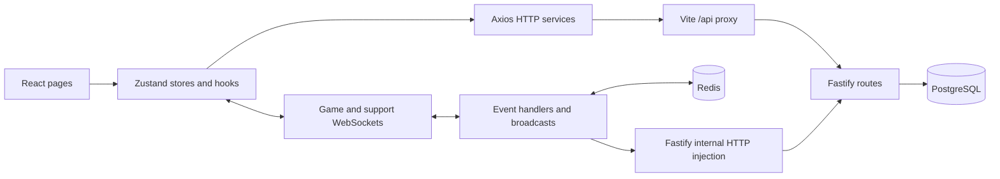
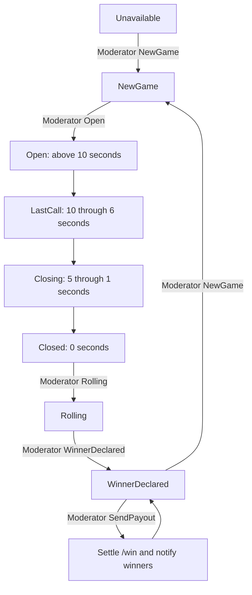

# Karera project flow, API reference, and integration checklist

Reviewed against the frontend and sibling `karera_back` source on 2026-10-11.
This is a source-code review, not a claim that every feature has passed an end-to-end test.
Paths beginning `../karera_back/` refer to the backend repository beside this frontend.

Quick navigation:

- [Project overview](#1-project-overview)
- [Startup and addresses](#2-startup-and-addresses)
- [Authentication](#3-user-and-authentication-flow)
- [Game records and setup](#4-game-setup-game-studio-room-and-session)
- [WebSocket protocol](#5-game-websocket-protocol)
- [Complete round and odds](#6-how-a-complete-game-round-works)
- [Support and game-site flow](#7-support-tickets-and-game-site-flow)
- [Frontend integration list](#8-frontend-integration-status-and-remaining-apis)
- [Prioritized checklist](#9-prioritized-implementation-checklist)
- [Source map](#10-source-map-for-future-changes)
- [HTTP endpoint inventory](#11-backend-http-endpoint-inventory)

## 1. Project overview

Karera is a role-based gaming application. Players register, log in, manage their
wallet, and place bets on live Dos Letra rounds. Moderators control rounds and
declare results. Other screens support hosts, customer support, operators,
representatives, administrators, and physical game sites.

| Component | Responsibility | Main source |
| --- | --- | --- |
| React frontend | Pages, forms, role navigation, live game UI | `src/main.tsx`, `src/routes/index.tsx` |
| Zustand stores | Authentication, wallet, room, and game UI state | `src/store/` |
| Axios services | HTTP calls and bearer-token attachment | `src/api/axiosInstance.ts`, `src/api/services/` |
| Fastify backend | Validation, authentication, business handlers, API docs | `../karera_back/src/main.ts`, `../karera_back/src/app.ts` |
| PostgreSQL + Drizzle | Users, wallets, transactions, games, rounds, bets, support records | `../karera_back/src/db/schema.ts` |
| Redis | Live studio state, bets for odds calculation, countdown, connected player sets | `../karera_back/src/api/dosletra/` |
| Game WebSocket | Moderator commands, player bets, live broadcasts | `../karera_back/src/api/dosletra/DosLetraPlugin.ts` |
| Support WebSocket | Support session commands and messages | `../karera_back/src/api/csr/CSRPlugin.ts` |



`fastify.inject()` calls a route inside the backend process. A WebSocket bet
therefore reuses the HTTP `/bet` handler without making an external network request.
PostgreSQL saves financial records; Redis drives live round calculations. They
can become inconsistent if only one side of an operation succeeds.

## 2. Startup and addresses

Start PostgreSQL and Redis first. With local `.env` files prepared, run the apps
in separate PowerShell terminals:

```powershell
# Terminal 1
cd C:\Users\Rio\Documents\node_projects\karera_back
npm run dev
```

```powershell
# Terminal 2
cd C:\Users\Rio\Documents\node_projects\karera_front
npm run dev
```

| Service | Local address |
| --- | --- |
| Frontend | `http://localhost:3000` |
| Backend | `http://127.0.0.1:8000` |
| Backend health | `http://127.0.0.1:8000/health` |
| Swagger API docs | `http://127.0.0.1:8000/docs` |
| PostgreSQL | `127.0.0.1:5432` |
| Redis in WSL, reachable from Windows | `127.0.0.1:6379` |
| Separate archive service | Configured by `VITE_API_ARCHIVE_URL`, sample port 8001 |
| Separate embedded game site | Defaults in `src/components/GamePage.tsx`, port 3001 |

The archive and embedded game site are separate services; starting this backend
does not start them. The local setup guide is `../karera_back/README.md`.

**HTTP prefix:** Axios uses `/api`. Vite removes that prefix before forwarding.
Browser `/api/login` becomes backend `/login`. The endpoint appendix below lists
backend paths; add `/api` when calling them through the frontend origin.

**WebSocket prefix:** The backend directly handles `/api/studio/:studioNo`.
That path does not use the HTTP proxy rewrite described above.

## 3. User and authentication flow

1. Registration and login use `POST /register` and `POST /login`.
2. The backend returns user information and a signed JWT. Both handlers create
   or replace the user's database session; an extra `/session` call is not needed
   for the current normal login flow.
3. `src/hooks/auth/userLogin.ts` saves the response through `useAuthStore`.
   Zustand persists it under browser local storage key `auth-storage`.
4. Frontend route guards select pages by role. Those guards protect navigation;
   each backend operation still needs its own authorization.
5. Axios reads the saved token and sends `Authorization: Bearer <token>`.
   An OTP reset token takes precedence when present in `useOtpStore`.
6. `globalAuthentication()` verifies the JWT and checks that its user/token pair
   still exists in `UserSessionTable`. Some plugins instead use JWT-only checks.
7. HTTP 401 responses clear saved auth and redirect to `/auth/login`.
8. Game WebSocket authentication currently verifies the JWT but does not make
   the same database-session check. Logout/session replacement does not by itself
   guarantee that an already authenticated socket is disconnected.
9. `/logout` currently returns a message asking the frontend to delete its token;
   it does not delete the database session. Add server-side revocation and socket
   invalidation rather than relying only on local storage cleanup.

Core account APIs include `/verify-login`, user listing/profile updates, password
reset/change, `/otp/request`, `/otp/verify`, and identity verification under `/ekyc`.
Their schemas and actual handlers are the source of truth for required fields.

## 4. Game setup: game, studio, room, and session

These terms describe different records:

| Term | Meaning |
| --- | --- |
| Game | Definition of a game, including choices such as A/B and commission |
| Studio | Live channel such as `DL01`; WebSocket and Redis state are scoped to it |
| Room | Connects a game to its studio and other room assignments |
| Game session | One persisted round, with its own ID, round code, and status |
| Bet | One choice and stake attached to a user transaction and session |

The current game plugin creates WebSocket servers for hardcoded studios `DL01`
through `DL04`. The seeder also creates `DL05`, so a database studio does not
automatically create a live WebSocket channel.

Before starting a round, a game must exist and have a matching non-deleted room.
`POST /game/session` looks up that room and returns the new session together with
`gameChoices`, `gameCommission`, and room/round information. If the room is missing,
the handler dereferences `room.id` and fails; the current setup is not self-healing.

## 5. Game WebSocket protocol

Canonical direct connection:

```text
ws://127.0.0.1:8000/api/studio/DL01
```

Messages are JSON and use this envelope:

```json
{"channel":"Game","state":"Authenticate","data":{"token":"<JWT>"}}
```

Successful authentication reply:

```json
{"channel":"Game","state":"Authenticate","data":"Success"}
```

Failures commonly use a top-level `error`; fields are optional, so an empty
payload may serialize to just `channel` and `state`.

| Direction | State | Data / purpose |
| --- | --- | --- |
| Client → server | `Authenticate` | `{token}`; first message identifies the user |
| Client → server | `Update` | `{}`; request a snapshot; reply state is the current round state |
| Moderator → server | `NewGame` | `{gameId}`; create a persisted round and initialize Redis |
| Moderator → server | `Open` | `{play:true}` or `{play:false}`; open or pause/resume countdown |
| Player → server | `Bet` | `{choice:"A",amount:100}`; submit a bet |
| Moderator → server | `Rolling` | `{}`; move a closed round to rolling |
| Moderator → server | `WinnerDeclared` | `{choice:"A"}`; record the winning choice |
| Moderator → server | `SendPayout` | `{}`; settle bets through `/win` |
| Client → server | `History` | `{gameId}`; request game history; current broadcast implementation needs repair |
| Server → clients | `Update` | `studio`, `commission`, `odds`, `net`, `gross`; normally once per second |
| Server → clients | `Open`, `LastCall`, `Closing`, `Closed` | `{countdown}` |
| Server → clients | `Rolling` | State notification |
| Server → clients | `WinnerDeclared` | `{choice}` |
| Server → clients | `NewGame` | Moderator gets `{sessionId}`; other clients receive the state |
| Server → bettor | `Bet` | `{choice,amount,balance}` on success, or top-level `error` |
| Server → winner | `Win` | `{wins,balance}` |
| Server → clients | `SendPayout` | `{topWinners}`; up to three winner entries |
| Server → clients | `PlayerCount` | `{playerCount}` |

`Join` exists in enums and Swagger placeholder routes, but the inspected game
message handlers do not implement it. Do not build frontend behavior around a
successful `Join` until a backend handler exists.

The browser wrapper queues messages until a connection opens and retries closed
connections after three seconds. Its store keeps an accumulating message array.
Player and moderator hooks consume the latest message and update UI state.

### Current connection caveat

`src/store/websocket/useWebsocket.ts` appends `/api` to `VITE_WS_URL`. With the
sample value this produces `/api/studio/DL01/api`. The backend currently accepts
it because it only checks the first path segments, but this is an accidental
compatibility. The fallback also cannot work: interpolating an unset environment
value produces the truthy string `undefined/api`. A future fix should use the
complete configured URL directly and define a valid fallback explicitly.

## 6. How a complete game round works



1. **Create round:** `Moderator.ts` receives `NewGame`, internally posts to
   `/game/session`, clears previous round keys, and saves the new session ID,
   choices, commission, round, and room in Redis. It emits `GameStateChanged`.
2. **Open betting:** `Open` sets the stored countdown to 61. At the default speed,
   the first tick broadcasts 60. `play:false` pauses decrements; `play:true` resumes.
3. **Accept bets:** Betting is accepted in `Open`, `LastCall`, and `Closing`.
   `Player.ts` checks duplicate choice bets in Redis and requires a session ID.
   It internally posts `{sessionId,choice,amount}` to `/bet` using the user's token.
4. **Save financial records:** `/bet` checks session/choice, wallet funds, and an
   existing same-choice bet. In a database transaction it increases
   `onHoldBalance`, inserts a transaction and bet, and returns available balance.
   The WebSocket handler then saves the accepted stake under the studio's Redis
   bet hash and acknowledges the bettor. A bet reserves funds rather than immediately
   subtracting the stake from the stored wallet balance.
5. **Broadcast odds:** `Broadcast.ts` asks `updateGameValues()` to aggregate Redis
   bets each second. The frontend updates A/B odds and pool values from `Update`.
6. **Close:** Countdown moves through last call and closing, then closed.
   The moderator must send `Rolling`; reaching zero does not automatically roll
   or decide a winner.
7. **Declare winner:** A moderator submits the choice. Its current odds and choice
   are stored in Redis and broadcast as `WinnerDeclared`.
8. **Send payout:** A separate moderator action collects Redis bets and computes
   winning stakes × winning odds. It internally posts session, choice, odds, and
   winners to `/win`.
9. **Settle:** `/win` processes persisted bets: subtract each stake from balance,
   release its hold, add winnings for winning bets, complete transaction records,
   update bet results, distribute referral commissions where configured, and
   update game-site bet results. The moderator handler then patches the session
   to `completed` and sends individual `Win` messages and a top-winners broadcast.
10. **Next round:** The broadcast handler returns the Redis state from `SendPayout`
    to `WinnerDeclared`; the moderator can send `NewGame` again. Current guards
    also permit `NewGame` before payout, so payout sequencing needs stronger enforcement.

### Odds example

The live calculation is:

```text
gross(choice) = sum of stakes on that choice
totalNet = totalGross × (1 − commission)
net(choice) = gross(choice) × (1 − commission)
odds(choice) = totalNet / gross(choice), or 0 if that choice has no stakes
winning payout = winning stake × stored winning odds
```

For A=1,000, B=500, and commission=10%, total net is 1,350. Odds are A=1.35
and B=2.70. A winning 100 stake returns 135; settlement subtracts the original
100 and adds 135, for a net gain of 35. These are source-calculation examples,
not a guarantee about concurrent settlement, rounding, or production correctness.

Redis keys include `DL01:state`, `DL01:sessionId`, `DL01:countdown`,
`DL01:choices`, `DL01:odds`, `DL01:bet:<mobile>`, and `DL01:allplayers`.
The Redis plugin namespace selects a client; it does not automatically provide
a separate Redis database. The current game plugin calls `flushdb()` on startup
and close, so Redis round data is cleared and a dedicated database is needed.

## 7. Support, tickets, and game-site flow

Support is a second WebSocket protocol. With the sample `CSR_ROUTE=/api/csr`,
connect directly to `ws://127.0.0.1:8000/api/csr`. Without that setting, the backend
fallback is `/csr`. Use channel `Support` and authenticate with `{token}`.

| Support state | Purpose |
| --- | --- |
| `Start` | Player sends initial `text` and `typeId`; handler creates a persisted session |
| `Message` | Send a message for a support session |
| `End` | End a support session |
| `ChatHistory` | Retrieve session message history |
| `ListSessions` | Retrieve support sessions |

The support handlers internally reuse `/csr/sessions` and its message endpoints.
Use each handler/schema for the exact fields beyond the verified `Start` payload.
Ticket endpoints under `/csr/tickets` provide assignment, status, and ticket logs.
`/ticket` is the separate game-site ticket flow, not a customer-support chat ticket.

The frontend game-site ticket hook already calls `POST /ticket` and opens the
print receipt using the response. That does not establish integration of the
separate `/gamesite/bet`, finalization, results, and transaction APIs.

## 8. Frontend integration status and remaining APIs

Status below is based on inspected service calls, endpoint constants, hooks,
and pages. A constant alone is not a working integration. 'No call found' means
no implementation was found in this frontend's current source, not that the
endpoint must be exposed to every user. External repositories were not audited.

| Area | Existing frontend wiring | Remaining work |
| --- | --- | --- |
| Authentication | Register/login/logout services and persisted auth store | Add startup `/verify-login` validation and consistent expired-session/socket handling |
| Game/player | Live authentication, bet command, countdown, odds, winner UI; `/game` listing | Fix URL/reconnect lifecycle; restore bets and round state after reconnect; integrate `/game/history/:id` and `/bet` reads for persisted history |
| Game administration | Game list, session creation service, `/game/:id/status` | Add create/update/delete game screens for `POST /game`, `PUT /game/:id`, `DELETE /game/:id`; session list/details where required |
| Rooms/hosts | Room create/list/detail/update, studio list, host list/detail/update/like | Wire room-session restoration `/room/session/:id`; add remaining host create/delete and unlike/check-like interactions where the UI needs them |
| Player wallet | `/balance`, PIN create/change/verify/status, payment deposit and withdraw services | Reconcile wallet after successful `Bet` and `Win`; add payment status polling `/payments/icore/status/:id` and clear pending/failure states |
| Customer support | Attendance HTTP services; player `ChatBox.tsx` currently uses local sample messages | Create a separate support socket store, connect to `/api/csr`, implement Start/Message/End/ChatHistory/ListSessions; integrate `/csr/session-types`, session/message reads, assignment/status and read receipts |
| Game-site | `/sites`, `/ticket` and receipt hook | Replace dummy bet transaction data with `/gamesite/transactions`; wire `/gamesite/bet`, `/gamesite/bet/finalize`, `/gamesite/bet/results`, and status update; add `/ticket/:ticketNumber` and `/all-tickets` lookup where required |
| Operator/representative | Operator code generation service | Integrate code listing, QR retrieval, operator/representative joins, representative code generation; integrate commission history `GET /commission/history` |
| Credits/transfers | No `/credits` HTTP integration found | Add `POST /credits` transfer and `GET /credits/history` history screens with validated permissions and wallet refresh |
| Gifts | No `/gift` HTTP integration found | Integrate gift submission, wallet refresh and gift broadcasts; add `/leaderboard/gift` display if required |
| Badges | No `/badges` HTTP integration found | Add user badge display `/badges/:userId`; creation/removal only for authorized administration |
| Identity verification | Create/upload selfie/upload ID/read service | Add review/status UI using `PATCH /ekyc/:userId/status` and appropriate read/list handlers; validate Zoloz setup and uploads end to end |
| Transactions/audits | Transaction list/report/player reads and audit list/create | Add transaction detail/update/delete only where business workflows require them; per-user audit reads if needed |
| Email | No `/email` integration found | Add email record read/status/delete interactions where required; these routes are not an email-send API |
| Archive | Direct archive API calls in archive pages/services | Start/configure separate archive service and validate its API contract; not provided by this backend |

Do not add frontend calls to payment callback endpoints: they are provider-to-backend
notifications. Swagger `/docs/ws/...` POST routes are documentation placeholders,
not a way to send live game commands. Debug/reset endpoints should not become normal
player features. `/posts` exists in frontend constants but no matching registered
backend route was found.

## 9. Prioritized implementation checklist

### First: make the existing live game reliable

- [ ] Fix WebSocket URL construction and choose studio from the selected room, rather than a fixed `DL01` environment setting.
- [ ] Reset connection/authentication flags on disconnect; authenticate again after every reconnect.
- [ ] Stop automatic reconnection after intentional cleanup; prevent duplicate clients and unbounded message history.
- [ ] Handle top-level WebSocket `error` responses in player/moderator UI. Wait for `Bet` acknowledgement before showing success or refreshing balance.
- [ ] Restore current countdown, choices, bets, round, and balance after reconnect. Current `Update` snapshot is incomplete.
- [ ] Enforce role, active session, current round state, and valid choice consistently in REST and WebSocket handlers. REST `/bet` currently does not enforce the live Redis betting window.
- [ ] Enforce settlement before a new round and make payout idempotent. Handle rounds with zero winning bets: `/win` currently rejects an empty winners list.
- [ ] Await `isGameSessionValid()` in winner/payout guards. It is async but currently used without `await`.
- [ ] Preserve failure state on payout errors; current handler can proceed to payout broadcast/state change after failure.
- [ ] Handle offline winners safely; payout notification code assumes a connected `userSocket` when reading names.
- [ ] Repair game chat/history helpers: standalone functions reference `this.studioNo` without a bound studio context.
- [ ] Repair the game-status event handler's use of the nested studio socket map.
- [ ] Move countdown state changes outside client loops so transitions occur even without connected clients.
- [ ] Isolate Redis and replace whole-database flushes with deliberate game-key cleanup; define a restart recovery strategy from persisted bets.
- [ ] Verify transaction locking, duplicate bets, concurrent wallet updates, and consistency between PostgreSQL and Redis.

### Next: finish frontend business flows

- [ ] Integrate real support sessions/messages instead of local chat sample state.
- [ ] Replace game-site dummy history with live transaction/result data.
- [ ] Add persisted bet/round history and a consistent wallet refresh after payout.
- [ ] Complete referral, credit, gift, badge, and email screens based on product scope.
- [ ] Complete admin game/host/site management and identity-review workflows.
- [ ] Add provider payment status, pending/failure UI, and validate callback settlement.
- [ ] Configure live video by studio: the player page currently contains a hardcoded playback URL.
- [ ] Configure and verify archive and embedded game-site services separately.
- [ ] Complete profile picture storage: the upload handler still builds an `/app/uploads/profiles` path and its directory creation/file writes are commented out. Replace that container-oriented path with configured local storage and serve the resulting files.

### Before deployment

- [ ] Review route authorization individually. Several sensitive routes lack a route-level auth guard; authenticated routes also need explicit role/ownership checks.
- [ ] Remove or restrict `/reset-all`, `/debug/*`, and JWT debug routes. `/reset-all` truncates database tables and reseeds.
- [ ] Fix `/session` and `/session/logout` token handling: handlers currently decode tokens rather than verify their signature.
- [ ] Separate game studio sockets from CSR user socket storage. CSR reuses `authenticatedSockets` with an incompatible key/value layout.
- [ ] Validate actual request/response schemas against frontend types. In particular, successful `Bet` sends `{choice,amount,balance}` while the player hook checks `data.A`/`data.B`.
- [ ] Verify protected PIN/site routes with and without trailing slashes; registered nested paths use `/wallet/pin/` and `/game-site/`, while some frontend calls omit the slash.
- [ ] Add end-to-end validation: login → room/studio → round → bet → close → winner → payout → wallet/history; include failed payouts, reloads, two studios, and disconnects.

## 10. Source map for future changes

| Question | Start here |
| --- | --- |
| Which pages can each role reach? | `src/routes/index.tsx`, `src/routes/ProtectedRoute.tsx` |
| Which HTTP paths does frontend use? | `src/api/endpoints.ts`, `src/api/services/` |
| How are tokens saved and sent? | `src/store/auth/useAuth.ts`, `src/api/axiosInstance.ts` |
| How does player UI react to game events? | `src/pages/player/pages/dos-letra/hooks/useDosLetraSocket.ts` |
| Where are player bet commands sent? | `src/pages/player/pages/dos-letra/component/GameBetModal.tsx` |
| Where are moderator commands sent? | `src/pages/moderator/components/HostDashboard.tsx`, its winner modal |
| Where are HTTP plugins registered? | `../karera_back/src/main.ts` |
| Where is the live protocol defined? | `../karera_back/src/api/dosletra/DosLetraPlugin.ts` |
| Where are round transitions controlled? | `../karera_back/src/api/dosletra/Moderator.ts` |
| Where are countdown and odds broadcast? | `../karera_back/src/api/dosletra/Broadcast.ts` |
| Where are WebSocket bets processed? | `../karera_back/src/api/dosletra/Player.ts` |
| Where are stakes and payouts saved? | `../karera_back/src/api/GameRoutesPlugin.ts` |
| Where does support use HTTP internally? | `../karera_back/src/api/csr/CSR.ts` |

## 11. Backend HTTP endpoint inventory

The following inventory is extracted from active route declarations in the
plugins imported by `src/main.ts`, excluding commented code. Nested registration
prefixes are included. `JWT guard` means an explicit authentication pre-handler
or inherited hook was found; it does not prove role authorization. `Handler check`
means token handling occurs inside that session handler. `No route guard` means
no explicit route-level auth was found; handlers may still perform additional checks.
Descriptions come from source schemas or handler names. Use Swagger and the linked
source for full bodies, query parameters, response shapes, and business constraints.

### dosletra/Dos Letra Plugin.ts

| Method | Backend path | Purpose | Auth | Request fields in schema | Source |
| --- | --- | --- | --- | --- | --- |
| GET | `/` | See handler | No route guard | See schema/handler | [dosletra/DosLetraPlugin.ts:74](../karera_back/src/api/dosletra/DosLetraPlugin.ts#L74) |

### User

| Method | Backend path | Purpose | Auth | Request fields in schema | Source |
| --- | --- | --- | --- | --- | --- |
| POST | `/register` | Register a new user | No route guard | Body: firstName, lastName, userName, email, mobile, type, password, ekycTransactionId, permanentAddress, currentAddress, birthDate, birthPlace, nationality, gamingSite, natureOfWork, sourceOfIncome, profileMeta | [UserRoutesPlugin.ts:50](../karera_back/src/api/UserRoutesPlugin.ts#L50) |
| POST | `/login` | Login a user | No route guard | Body: userNameOrEmail, password | [UserRoutesPlugin.ts:51](../karera_back/src/api/UserRoutesPlugin.ts#L51) |
| POST | `/logout` | Logout user (stateless, just a message) | JWT guard | See schema/handler | [UserRoutesPlugin.ts:52](../karera_back/src/api/UserRoutesPlugin.ts#L52) |
| GET | `/verify-login` | Verify JWT and return user info | JWT guard | See schema/handler | [UserRoutesPlugin.ts:53](../karera_back/src/api/UserRoutesPlugin.ts#L53) |
| GET | `/debug-jwt` | Decode and log JWT token from Authorization header | No route guard | See schema/handler | [UserRoutesPlugin.ts:54](../karera_back/src/api/UserRoutesPlugin.ts#L54) |
| GET | `/users` | Get all users with pagination | JWT guard | Query: limit, offset, type, startDate, endDate, search | [UserRoutesPlugin.ts:55](../karera_back/src/api/UserRoutesPlugin.ts#L55) |
| POST | `/users/update-password` | Update user password without Email or confirm password | JWT guard | Body: userNameOrEmail, newPassword | [UserRoutesPlugin.ts:56](../karera_back/src/api/UserRoutesPlugin.ts#L56) |
| POST | `/users/reset-password` | Request a password update link via email | No route guard | Body: userNameOrEmail | [UserRoutesPlugin.ts:57](../karera_back/src/api/UserRoutesPlugin.ts#L57) |
| POST | `/users/confirm-reset-password` | Confirm password update via sms | No route guard | Body: otp, userName, newPassword, confirmNewPassword | [UserRoutesPlugin.ts:58](../karera_back/src/api/UserRoutesPlugin.ts#L58) |
| GET | `/users/:id` | Get a user by ID | JWT guard | See schema/handler | [UserRoutesPlugin.ts:63](../karera_back/src/api/UserRoutesPlugin.ts#L63) |
| PATCH | `/users/:id` | Update a user by ID | JWT guard | Body: firstName, lastName, userName, email, mobile, type, status, profileMeta | [UserRoutesPlugin.ts:64](../karera_back/src/api/UserRoutesPlugin.ts#L64) |
| POST | `/users/:id/profile-picture` | Upload profile picture for a user | JWT guard | See schema/handler | [UserRoutesPlugin.ts:66](../karera_back/src/api/UserRoutesPlugin.ts#L66) |
| DELETE | `/users/:id/profile-picture` | Delete a user’s profile photo | JWT guard | See schema/handler | [UserRoutesPlugin.ts:67](../karera_back/src/api/UserRoutesPlugin.ts#L67) |
| PATCH | `/users/:id/nickname` | Update user's nickname in profile meta | JWT guard | Body: nickname | [UserRoutesPlugin.ts:68](../karera_back/src/api/UserRoutesPlugin.ts#L68) |

### Transaction

| Method | Backend path | Purpose | Auth | Request fields in schema | Source |
| --- | --- | --- | --- | --- | --- |
| POST | `/deposit` | Create a new deposit. | JWT guard | Body: amount | [TransactionRoutesPlugin.ts:28](../karera_back/src/api/TransactionRoutesPlugin.ts#L28) |
| POST | `/withdraw` | Create a new withdrawal. | JWT guard | Body: amount | [TransactionRoutesPlugin.ts:29](../karera_back/src/api/TransactionRoutesPlugin.ts#L29) |
| GET | `/transactions` | Get transactions with pagination and category filter | JWT guard | Query: limit, offset, category, startDate, endDate | [TransactionRoutesPlugin.ts:30](../karera_back/src/api/TransactionRoutesPlugin.ts#L30) |
| GET | `/transactions/report` | Transactions report with bet, win, GGR and fee shares | No route guard | Query: period, startDate, endDate | [TransactionRoutesPlugin.ts:31](../karera_back/src/api/TransactionRoutesPlugin.ts#L31) |
| GET | `/transactions/:id` | Get a single transaction by ID. | JWT guard | See schema/handler | [TransactionRoutesPlugin.ts:32](../karera_back/src/api/TransactionRoutesPlugin.ts#L32) |
| PATCH | `/transactions/:id` | Update a transaction by ID | JWT guard | Body: status | [TransactionRoutesPlugin.ts:33](../karera_back/src/api/TransactionRoutesPlugin.ts#L33) |
| DELETE | `/transactions/:id` | Delete a transaction by ID | JWT guard | See schema/handler | [TransactionRoutesPlugin.ts:34](../karera_back/src/api/TransactionRoutesPlugin.ts#L34) |
| GET | `/transactions/player` | Get authenticated player's transactions with filters | JWT guard | Query: limit, type, startDate, endDate | [TransactionRoutesPlugin.ts:37](../karera_back/src/api/TransactionRoutesPlugin.ts#L37) |

### Wallet

| Method | Backend path | Purpose | Auth | Request fields in schema | Source |
| --- | --- | --- | --- | --- | --- |
| GET | `/wallet` | Get all wallets for authenticated user | JWT guard | See schema/handler | [WalletRoutesPlugin.ts:14](../karera_back/src/api/WalletRoutesPlugin.ts#L14) |
| PATCH | `/wallet` | Update wallet details | JWT guard | Body: status, balance | [WalletRoutesPlugin.ts:15](../karera_back/src/api/WalletRoutesPlugin.ts#L15) |
| DELETE | `/wallet/:id` | Delete wallet (soft delete) | JWT guard | See schema/handler | [WalletRoutesPlugin.ts:16](../karera_back/src/api/WalletRoutesPlugin.ts#L16) |
| POST | `/wallet/deposit` | Deposit money to your account. | JWT guard | Body: amount | [WalletRoutesPlugin.ts:21](../karera_back/src/api/WalletRoutesPlugin.ts#L21) |
| POST | `/wallet/withdraw` | Withdraw money from your account. | JWT guard | Body: amount | [WalletRoutesPlugin.ts:22](../karera_back/src/api/WalletRoutesPlugin.ts#L22) |
| GET | `/balance` | Get balances for all wallet types. | JWT guard | See schema/handler | [WalletRoutesPlugin.ts:23](../karera_back/src/api/WalletRoutesPlugin.ts#L23) |
| POST | `/balance/reset` | Get balances for all wallet types. | JWT guard | See schema/handler | [WalletRoutesPlugin.ts:24](../karera_back/src/api/WalletRoutesPlugin.ts#L24) |

### Game

| Method | Backend path | Purpose | Auth | Request fields in schema | Source |
| --- | --- | --- | --- | --- | --- |
| POST | `/game` | Create a new game | JWT guard | Body: name, choices, commission | [GameRoutesPlugin.ts:27](../karera_back/src/api/GameRoutesPlugin.ts#L27) |
| GET | `/game` | Get all games with optional search and pagination | JWT guard | Query: search, limit, offset | [GameRoutesPlugin.ts:28](../karera_back/src/api/GameRoutesPlugin.ts#L28) |
| GET | `/game/:id` | Get a game by ID | JWT guard | See schema/handler | [GameRoutesPlugin.ts:29](../karera_back/src/api/GameRoutesPlugin.ts#L29) |
| PUT | `/game/:id` | Update a game by ID | JWT guard | Body: name, choices | [GameRoutesPlugin.ts:30](../karera_back/src/api/GameRoutesPlugin.ts#L30) |
| DELETE | `/game/:id` | Soft delete a game by ID | JWT guard | See schema/handler | [GameRoutesPlugin.ts:31](../karera_back/src/api/GameRoutesPlugin.ts#L31) |
| PATCH | `/game/:id/status` | Update game status (enable or disable). | JWT guard | Body: status | [GameRoutesPlugin.ts:32](../karera_back/src/api/GameRoutesPlugin.ts#L32) |
| POST | `/game/session` | Create a new game session | JWT guard | Body: gameId | [GameRoutesPlugin.ts:35](../karera_back/src/api/GameRoutesPlugin.ts#L35) |
| GET | `/game/session` | Get all game sessions with optional filters | JWT guard | Query: gameId, limit, offset | [GameRoutesPlugin.ts:36](../karera_back/src/api/GameRoutesPlugin.ts#L36) |
| GET | `/game/session/:id` | Get a game session by ID | JWT guard | See schema/handler | [GameRoutesPlugin.ts:37](../karera_back/src/api/GameRoutesPlugin.ts#L37) |
| DELETE | `/game/session/:id` | Soft delete a game session by ID | JWT guard | See schema/handler | [GameRoutesPlugin.ts:38](../karera_back/src/api/GameRoutesPlugin.ts#L38) |
| PATCH | `/game/session/:id` | Update game session status | JWT guard | Body: status | [GameRoutesPlugin.ts:39](../karera_back/src/api/GameRoutesPlugin.ts#L39) |
| POST | `/bet` | Place a bet on a game session | JWT guard | Body: sessionId, amount, choice | [GameRoutesPlugin.ts:42](../karera_back/src/api/GameRoutesPlugin.ts#L42) |
| GET | `/bet` | Get bets with optional filtering by sessionId | JWT guard | See schema/handler | [GameRoutesPlugin.ts:43](../karera_back/src/api/GameRoutesPlugin.ts#L43) |
| POST | `/win` | Record a winning bet and update winAmount for a game session | JWT guard | Body: sessionId, choice, odds, winners | [GameRoutesPlugin.ts:45](../karera_back/src/api/GameRoutesPlugin.ts#L45) |
| GET | `/game/history/:id` | Get a game bets history by game id | JWT guard | See schema/handler | [GameRoutesPlugin.ts:70](../karera_back/src/api/GameRoutesPlugin.ts#L70) |

### Ekyc

| Method | Backend path | Purpose | Auth | Request fields in schema | Source |
| --- | --- | --- | --- | --- | --- |
| GET | `/ekyc` | Get all eKYC details with pagination | No route guard | Query: limit, offset, status, age, submittedAt, deletedAt | [EkycRoutesPlugin.ts:21](../karera_back/src/api/EkycRoutesPlugin.ts#L21) |
| GET | `/ekyc/:userId` | Get eKYC details for a user by ID | JWT guard | See schema/handler | [EkycRoutesPlugin.ts:22](../karera_back/src/api/EkycRoutesPlugin.ts#L22) |
| POST | `/ekyc` | Create Initial eKYC record No Image as it will be handled by Zoloz | JWT guard | Body: userId, status | [EkycRoutesPlugin.ts:23](../karera_back/src/api/EkycRoutesPlugin.ts#L23) |
| PATCH | `/ekyc/:userId` | Update eKYC details for a user | JWT guard | Body: birthPlace, birthDate, type | [EkycRoutesPlugin.ts:24](../karera_back/src/api/EkycRoutesPlugin.ts#L24) |
| PATCH | `/ekyc/:userId/status` | Update eKYC status (Admin only) | JWT guard | Body: status | [EkycRoutesPlugin.ts:25](../karera_back/src/api/EkycRoutesPlugin.ts#L25) |
| DELETE | `/ekyc/:userId` | Delete eKYC details for a user by ID | JWT guard | See schema/handler | [EkycRoutesPlugin.ts:26](../karera_back/src/api/EkycRoutesPlugin.ts#L26) |
| POST | `/ekyc/:id/liveness` | Upload selfie for manual eKYC verification | JWT guard | See schema/handler | [EkycRoutesPlugin.ts:28](../karera_back/src/api/EkycRoutesPlugin.ts#L28) |
| POST | `/ekyc/:id/id` | Upload ID front and back images for manual eKYC verification | JWT guard | See schema/handler | [EkycRoutesPlugin.ts:29](../karera_back/src/api/EkycRoutesPlugin.ts#L29) |

### Debug

| Method | Backend path | Purpose | Auth | Request fields in schema | Source |
| --- | --- | --- | --- | --- | --- |
| POST | `/debug/clear-all` | Clear all tables in the database (DANGEROUS - USE ONLY FOR DEBUGGING) | JWT guard | See schema/handler | [DebugRoutesPlugin.ts:189](../karera_back/src/api/DebugRoutesPlugin.ts#L189) |
| POST | `/debug/clear-tables` | Clear specific tables in the database (DANGEROUS - USE ONLY FOR DEBUGGING) | JWT guard | Body: tables | [DebugRoutesPlugin.ts:194](../karera_back/src/api/DebugRoutesPlugin.ts#L194) |
| GET | `/debug/tables` | Get all available tables in the database | JWT guard | See schema/handler | [DebugRoutesPlugin.ts:199](../karera_back/src/api/DebugRoutesPlugin.ts#L199) |
| POST | `/debug/execute-seeder` | Execute a seeder script by name | JWT guard | Body: seederName | [DebugRoutesPlugin.ts:204](../karera_back/src/api/DebugRoutesPlugin.ts#L204) |
| POST | `/debug/reset` | Reset the entire database by dropping all tables and running migrations (DANGEROUS - USE ONLY FOR DEBUGGING) | JWT guard | Body: confirmReset, runMigrations | [DebugRoutesPlugin.ts:209](../karera_back/src/api/DebugRoutesPlugin.ts#L209) |

### Ticket

| Method | Backend path | Purpose | Auth | Request fields in schema | Source |
| --- | --- | --- | --- | --- | --- |
| POST | `/ticket` | create Ticket | No route guard | Body: gameId, choice, amount | [TicketRoutesPlugin.ts:171](../karera_back/src/api/TicketRoutesPlugin.ts#L171) |
| GET | `/ticket/:ticketNumber` | get Ticket | No route guard | See schema/handler | [TicketRoutesPlugin.ts:172](../karera_back/src/api/TicketRoutesPlugin.ts#L172) |
| GET | `/all-tickets` | get All Tickets | No route guard | See schema/handler | [TicketRoutesPlugin.ts:173](../karera_back/src/api/TicketRoutesPlugin.ts#L173) |

### Leader Board

| Method | Backend path | Purpose | Auth | Request fields in schema | Source |
| --- | --- | --- | --- | --- | --- |
| GET | `/leaderboard` | get Leaderboard Handler | No route guard | Query: limit, startDate, endDate, gameId | [LeaderBoardRoutePlugin.ts:67](../karera_back/src/api/LeaderBoardRoutePlugin.ts#L67) |
| GET | `/leaderboard/gift` | get Leaderboard Handler | No route guard | Query: limit, startDate, endDate, gameId | [LeaderBoardRoutePlugin.ts:70](../karera_back/src/api/LeaderBoardRoutePlugin.ts#L70) |

### Rooms

| Method | Backend path | Purpose | Auth | Request fields in schema | Source |
| --- | --- | --- | --- | --- | --- |
| POST | `/rooms` | Create a new game room session. | JWT guard | Body: gameId, hostId, studioNo | [RoomsRoutesPlugin.ts:12](../karera_back/src/api/RoomsRoutesPlugin.ts#L12) |
| GET | `/rooms` | Get all rooms. | JWT guard | Query: limit, offset, status | [RoomsRoutesPlugin.ts:13](../karera_back/src/api/RoomsRoutesPlugin.ts#L13) |
| GET | `/rooms/:id` | Get room by ID. | JWT guard | See schema/handler | [RoomsRoutesPlugin.ts:14](../karera_back/src/api/RoomsRoutesPlugin.ts#L14) |
| PATCH | `/rooms/:id` | Update room by ID. You have full control over the room status and host. <br> If you want to remove the host, set hostId empty string. | JWT guard | Body: gameId, hostId, status | [RoomsRoutesPlugin.ts:15](../karera_back/src/api/RoomsRoutesPlugin.ts#L15) |
| GET | `/studios` | Get all studios. | JWT guard | Query: limit, offset | [RoomsRoutesPlugin.ts:16](../karera_back/src/api/RoomsRoutesPlugin.ts#L16) |
| GET | `/room/session/:id` | Get a room by ID | JWT guard | See schema/handler | [RoomsRoutesPlugin.ts:17](../karera_back/src/api/RoomsRoutesPlugin.ts#L17) |

### Host

| Method | Backend path | Purpose | Auth | Request fields in schema | Source |
| --- | --- | --- | --- | --- | --- |
| POST | `/hosts` | Create a new host. | No route guard | Body: name, location, birthDate, zodiac, talent | [HostRoutesPlugin.ts:208](../karera_back/src/api/HostRoutesPlugin.ts#L208) |
| GET | `/hosts` | Get all hosts. | No route guard | Query: limit, offset | [HostRoutesPlugin.ts:209](../karera_back/src/api/HostRoutesPlugin.ts#L209) |
| GET | `/hosts/:id` | Get host by ID. | No route guard | See schema/handler | [HostRoutesPlugin.ts:210](../karera_back/src/api/HostRoutesPlugin.ts#L210) |
| PATCH | `/hosts/:id` | Update host by ID. | No route guard | Body: name, location, birthDate, zodiac, talent | [HostRoutesPlugin.ts:211](../karera_back/src/api/HostRoutesPlugin.ts#L211) |
| DELETE | `/hosts/:id` | Soft delete host by ID. | No route guard | See schema/handler | [HostRoutesPlugin.ts:212](../karera_back/src/api/HostRoutesPlugin.ts#L212) |
| POST | `/likehost` | Like a host by userId. This will add a new row in likes table. | No route guard | Body: userId, hostId | [HostRoutesPlugin.ts:214](../karera_back/src/api/HostRoutesPlugin.ts#L214) |
| DELETE | `/likehost` | Unlike a host (delete the like row in likes table). | No route guard | Body: userId, hostId | [HostRoutesPlugin.ts:215](../karera_back/src/api/HostRoutesPlugin.ts#L215) |
| GET | `/likehost/:userId/:hostId` | Check if the user already liked the host. Will return a boolean if liked or not. | No route guard | See schema/handler | [HostRoutesPlugin.ts:216](../karera_back/src/api/HostRoutesPlugin.ts#L216) |

### Attendance

| Method | Backend path | Purpose | Auth | Request fields in schema | Source |
| --- | --- | --- | --- | --- | --- |
| POST | `/attendance` | Create attendance record | JWT guard | Body: userId, date, checkIn, checkOut | [AttendanceRoutesPlugin.ts:195](../karera_back/src/api/AttendanceRoutesPlugin.ts#L195) |
| GET | `/attendance` | Get all attendance records | JWT guard | Query: limit, offset, startDate, endDate, userId | [AttendanceRoutesPlugin.ts:202](../karera_back/src/api/AttendanceRoutesPlugin.ts#L202) |
| GET | `/attendance/user/:userId` | Get attendance records by userId | JWT guard | Query: limit, offset, startDate, endDate | [AttendanceRoutesPlugin.ts:209](../karera_back/src/api/AttendanceRoutesPlugin.ts#L209) |
| PATCH | `/attendance/:id` | Update attendance record | JWT guard | Body: checkIn, checkOut, status | [AttendanceRoutesPlugin.ts:217](../karera_back/src/api/AttendanceRoutesPlugin.ts#L217) |
| DELETE | `/attendance/:id` | Delete attendance record | JWT guard | See schema/handler | [AttendanceRoutesPlugin.ts:224](../karera_back/src/api/AttendanceRoutesPlugin.ts#L224) |

### Health

| Method | Backend path | Purpose | Auth | Request fields in schema | Source |
| --- | --- | --- | --- | --- | --- |
| GET | `/health` | Health Checker | No route guard | See schema/handler | [HealthRoutesPlugin.ts:15](../karera_back/src/api/HealthRoutesPlugin.ts#L15) |

### Wallet Pin

| Method | Backend path | Purpose | Auth | Request fields in schema | Source |
| --- | --- | --- | --- | --- | --- |
| POST | `/wallet/pin/` | Create PIN for wallet | JWT guard | Body: pin | [WalletPinRoutesPlugin.ts:151](../karera_back/src/api/WalletPinRoutesPlugin.ts#L151) |
| PATCH | `/wallet/pin/` | Update wallet PIN | JWT guard | Body: pin | [WalletPinRoutesPlugin.ts:152](../karera_back/src/api/WalletPinRoutesPlugin.ts#L152) |
| POST | `/wallet/pin/verify` | Verify wallet PIN | JWT guard | Body: pin | [WalletPinRoutesPlugin.ts:153](../karera_back/src/api/WalletPinRoutesPlugin.ts#L153) |
| GET | `/wallet/pin/status` | Check if user has active PIN | JWT guard | See schema/handler | [WalletPinRoutesPlugin.ts:154](../karera_back/src/api/WalletPinRoutesPlugin.ts#L154) |

### Password

| Method | Backend path | Purpose | Auth | Request fields in schema | Source |
| --- | --- | --- | --- | --- | --- |
| PATCH | `/password/change` | See handler | JWT guard | See schema/handler | [PasswordRoutesPlugin.ts:63](../karera_back/src/api/PasswordRoutesPlugin.ts#L63) |
| PATCH | `/password/reset` | See handler | JWT guard | See schema/handler | [PasswordRoutesPlugin.ts:64](../karera_back/src/api/PasswordRoutesPlugin.ts#L64) |

### One Time Pin Code

| Method | Backend path | Purpose | Auth | Request fields in schema | Source |
| --- | --- | --- | --- | --- | --- |
| POST | `/otp/request` | request Otp Code | No route guard | Body: mobile | [OneTimePinCodeRoutesPlugin.ts:103](../karera_back/src/api/OneTimePinCodeRoutesPlugin.ts#L103) |
| POST | `/otp/verify` | verify Otp Code | No route guard | Body: mobile, otp | [OneTimePinCodeRoutesPlugin.ts:104](../karera_back/src/api/OneTimePinCodeRoutesPlugin.ts#L104) |

### Payments

| Method | Backend path | Purpose | Auth | Request fields in schema | Source |
| --- | --- | --- | --- | --- | --- |
| GET | `/payments/icore/balance` | icore Balance | JWT guard | See schema/handler | [PaymentsRoutesPlugin.ts:137](../karera_back/src/api/PaymentsRoutesPlugin.ts#L137) |
| GET | `/payments/icore/status/:id` | Icore Transaction Status | JWT guard | See schema/handler | [PaymentsRoutesPlugin.ts:139](../karera_back/src/api/PaymentsRoutesPlugin.ts#L139) |
| POST | `/payments/icore/deposit` | Icore Deposit | JWT guard | Body: amount, fullName, email, phoneNumber, address, remark | [PaymentsRoutesPlugin.ts:141](../karera_back/src/api/PaymentsRoutesPlugin.ts#L141) |
| POST | `/payments/icore/callbackDeposit` | ICore Deposit Callback | No route guard | See schema/handler | [PaymentsRoutesPlugin.ts:142](../karera_back/src/api/PaymentsRoutesPlugin.ts#L142) |
| POST | `/payments/icore/withdraw` | Icore Withdraw | JWT guard | Body: amount, bankId, accountNumber, fullName, email, phoneNumber, address, remark | [PaymentsRoutesPlugin.ts:144](../karera_back/src/api/PaymentsRoutesPlugin.ts#L144) |
| POST | `/payments/icore/callbackWithdraw` | ICore Withdraw Callback | No route guard | See schema/handler | [PaymentsRoutesPlugin.ts:145](../karera_back/src/api/PaymentsRoutesPlugin.ts#L145) |
| POST | `/payments/ub/deposit` | UnionBank Deposit | JWT guard | Body: amount, fullName, email, phoneNumber, address, remark | [PaymentsRoutesPlugin.ts:147](../karera_back/src/api/PaymentsRoutesPlugin.ts#L147) |
| POST | `/payments/ub/callbackDeposit` | ub Deposit Callback | No route guard | See schema/handler | [PaymentsRoutesPlugin.ts:148](../karera_back/src/api/PaymentsRoutesPlugin.ts#L148) |
| GET | `/payments/ub/callbackDeposit` | ub Deposit Callback | No route guard | See schema/handler | [PaymentsRoutesPlugin.ts:149](../karera_back/src/api/PaymentsRoutesPlugin.ts#L149) |
| POST | `/payments/ub/withdraw` | UnionBank Withdraw | JWT guard | Body: accountNumber, amount, fullName, remark | [PaymentsRoutesPlugin.ts:151](../karera_back/src/api/PaymentsRoutesPlugin.ts#L151) |

### Game Site

| Method | Backend path | Purpose | Auth | Request fields in schema | Source |
| --- | --- | --- | --- | --- | --- |
| GET | `/game-site/` | get Gaming Site | JWT guard | See schema/handler | [GameSiteRoutesPlugin.ts:18](../karera_back/src/api/GameSiteRoutesPlugin.ts#L18) |
| POST | `/game-site/` | create Gaming Site | JWT guard | Body: name, gameSiteId, description | [GameSiteRoutesPlugin.ts:19](../karera_back/src/api/GameSiteRoutesPlugin.ts#L19) |
| GET | `/game-site/:id` | get Gaming Site By Id | JWT guard | See schema/handler | [GameSiteRoutesPlugin.ts:20](../karera_back/src/api/GameSiteRoutesPlugin.ts#L20) |
| PATCH | `/game-site/:id` | update Gaming Site | JWT guard | Body: name, description | [GameSiteRoutesPlugin.ts:21](../karera_back/src/api/GameSiteRoutesPlugin.ts#L21) |
| DELETE | `/game-site/:id` | delete Gaming Site | JWT guard | See schema/handler | [GameSiteRoutesPlugin.ts:22](../karera_back/src/api/GameSiteRoutesPlugin.ts#L22) |
| GET | `/sites` | get Gaming Sites | No route guard | See schema/handler | [GameSiteRoutesPlugin.ts:27](../karera_back/src/api/GameSiteRoutesPlugin.ts#L27) |
| POST | `/gamesite/bet` | create Game Site Bet | JWT guard | Body: representativeId, gameSiteId, gameSessionId, choice, amount | [GameSiteRoutesPlugin.ts:29](../karera_back/src/api/GameSiteRoutesPlugin.ts#L29) |
| POST | `/gamesite/bet/finalize` | finalize Game Site Bet | JWT guard | Body: representativeId, gameSessionId | [GameSiteRoutesPlugin.ts:30](../karera_back/src/api/GameSiteRoutesPlugin.ts#L30) |
| GET | `/gamesite/bet/results` | get Game Site Bet Results | JWT guard | Query: gameSessionId, representativeId, gameSiteId, status | [GameSiteRoutesPlugin.ts:31](../karera_back/src/api/GameSiteRoutesPlugin.ts#L31) |
| GET | `/gamesite/transactions` | get Game Site Bets Transaction | JWT guard | Query: gameSiteId, kioskPlayerId, gameSessionId, status, ticketId, startDate, endDate, limit, offset | [GameSiteRoutesPlugin.ts:32](../karera_back/src/api/GameSiteRoutesPlugin.ts#L32) |
| PATCH | `/gamesite/:id` | update Game Site Bet Status | JWT guard | Body: status, notes | [GameSiteRoutesPlugin.ts:33](../karera_back/src/api/GameSiteRoutesPlugin.ts#L33) |

### Gift

| Method | Backend path | Purpose | Auth | Request fields in schema | Source |
| --- | --- | --- | --- | --- | --- |
| POST | `/gift` | Send gifts to a host. 💡 Once successful, the gift is broadcasted in real-time to all connected WebSocket clients under `channel: "Gift"` and `state: "Send"`. | JWT guard | Body: hostId, amount, giftType, multiplier | [GiftRoutePlugin.ts:144](../karera_back/src/api/GiftRoutePlugin.ts#L144) |

### CSR

| Method | Backend path | Purpose | Auth | Request fields in schema | Source |
| --- | --- | --- | --- | --- | --- |
| GET | `/csr/tickets` | get All Tickets | No route guard | See schema/handler | [CSRRoutePlugin.ts:14](../karera_back/src/api/CSRRoutePlugin.ts#L14) |
| POST | `/csr/ticket` | create Ticket | No route guard | Body: userId, subject, priority, message | [CSRRoutePlugin.ts:15](../karera_back/src/api/CSRRoutePlugin.ts#L15) |
| POST | `/csr/tickets/:id/assign` | assign Ticket | No route guard | Body: assigneeId, actorId | [CSRRoutePlugin.ts:16](../karera_back/src/api/CSRRoutePlugin.ts#L16) |
| POST | `/csr/tickets/:id/status` | update Ticket Status | No route guard | Body: status, actorId, notes | [CSRRoutePlugin.ts:17](../karera_back/src/api/CSRRoutePlugin.ts#L17) |
| GET | `/csr/tickets/:id` | get Ticket | No route guard | See schema/handler | [CSRRoutePlugin.ts:18](../karera_back/src/api/CSRRoutePlugin.ts#L18) |
| POST | `/csr/tickets/:id/messages` | add Ticket Message | No route guard | Body: senderId, message, attachments | [CSRRoutePlugin.ts:19](../karera_back/src/api/CSRRoutePlugin.ts#L19) |
| POST | `/csr/sessions` | create Chat Session | JWT guard | Body: mobile, typeId, message | [CSRRoutePlugin.ts:24](../karera_back/src/api/CSRRoutePlugin.ts#L24) |
| GET | `/csr/sessions` | List chat sessions with profile, last message, and read status | JWT guard | Query: status, limit | [CSRRoutePlugin.ts:25](../karera_back/src/api/CSRRoutePlugin.ts#L25) |
| PATCH | `/csr/sessions/:id` | End or update a chat session | JWT guard | See schema/handler | [CSRRoutePlugin.ts:26](../karera_back/src/api/CSRRoutePlugin.ts#L26) |
| POST | `/csr/sessions/:id/messages` | Send a new chat message in a session | JWT guard | Body: mobile, message | [CSRRoutePlugin.ts:27](../karera_back/src/api/CSRRoutePlugin.ts#L27) |
| GET | `/csr/sessions/:id/messages` | Get chat messages for a session | JWT guard | Query: limit | [CSRRoutePlugin.ts:28](../karera_back/src/api/CSRRoutePlugin.ts#L28) |
| PATCH | `/csr/sessions/:id/messages/:msgId` | Mark a chat message as read | JWT guard | See schema/handler | [CSRRoutePlugin.ts:29](../karera_back/src/api/CSRRoutePlugin.ts#L29) |
| GET | `/csr/session-types` | List all chat session types | JWT guard | See schema/handler | [CSRRoutePlugin.ts:30](../karera_back/src/api/CSRRoutePlugin.ts#L30) |
| POST | `/csr/session-types` | Create a new chat session type | JWT guard | Body: name, code | [CSRRoutePlugin.ts:31](../karera_back/src/api/CSRRoutePlugin.ts#L31) |

### Operator

| Method | Backend path | Purpose | Auth | Request fields in schema | Source |
| --- | --- | --- | --- | --- | --- |
| GET | `/operator/join/player/:code` | join Handler | JWT guard | See schema/handler | [OperatorRoutePlugin.ts:15](../karera_back/src/api/OperatorRoutePlugin.ts#L15) |
| GET | `/operator/join/representative/:code` | join Handler | JWT guard | See schema/handler | [OperatorRoutePlugin.ts:29](../karera_back/src/api/OperatorRoutePlugin.ts#L29) |
| GET | `/operator/codes` | get Referral Codes | JWT guard | See schema/handler | [OperatorRoutePlugin.ts:43](../karera_back/src/api/OperatorRoutePlugin.ts#L43) |
| GET | `/operator/:code` | get Referral Code QR | JWT guard | Query: repType | [OperatorRoutePlugin.ts:44](../karera_back/src/api/OperatorRoutePlugin.ts#L44) |
| POST | `/operator/generate/code` | generate Operator Code | JWT guard | Body: pctOperator, pctRep1, pctRep2, codeType, repType | [OperatorRoutePlugin.ts:47](../karera_back/src/api/OperatorRoutePlugin.ts#L47) |
| POST | `/operator/join/player/:code` | join Handler | JWT guard | Body: repType; Query: repType | [OperatorRoutePlugin.ts:49](../karera_back/src/api/OperatorRoutePlugin.ts#L49) |
| POST | `/operator/join/representative/:code` | join Handler | JWT guard | Body: repType; Query: repType | [OperatorRoutePlugin.ts:55](../karera_back/src/api/OperatorRoutePlugin.ts#L55) |

### Representative

| Method | Backend path | Purpose | Auth | Request fields in schema | Source |
| --- | --- | --- | --- | --- | --- |
| POST | `/representative/join/player/:code` | join With Rep Unified Handler | JWT guard | Body: target; Query: target | [RepresentativeRoutePlugin.ts:13](../karera_back/src/api/RepresentativeRoutePlugin.ts#L13) |
| POST | `/representative/join/:code` | join With Rep Unified Handler | JWT guard | Body: target; Query: target | [RepresentativeRoutePlugin.ts:18](../karera_back/src/api/RepresentativeRoutePlugin.ts#L18) |
| POST | `/representative/generate/code` | generate Representative Code | JWT guard | Body: referralCodeId, target | [RepresentativeRoutePlugin.ts:24](../karera_back/src/api/RepresentativeRoutePlugin.ts#L24) |
| GET | `/representative/codes` | get Referral Codes | JWT guard | See schema/handler | [RepresentativeRoutePlugin.ts:30](../karera_back/src/api/RepresentativeRoutePlugin.ts#L30) |
| GET | `/representative/:code` | get Referral Code QR | JWT guard | Query: target | [RepresentativeRoutePlugin.ts:31](../karera_back/src/api/RepresentativeRoutePlugin.ts#L31) |
| GET | `/representative/join/player/:code` | join With Rep Unified Handler | JWT guard | See schema/handler | [RepresentativeRoutePlugin.ts:34](../karera_back/src/api/RepresentativeRoutePlugin.ts#L34) |
| GET | `/representative/join/:code` | join With Rep Unified Handler | JWT guard | See schema/handler | [RepresentativeRoutePlugin.ts:47](../karera_back/src/api/RepresentativeRoutePlugin.ts#L47) |

### Commission

| Method | Backend path | Purpose | Auth | Request fields in schema | Source |
| --- | --- | --- | --- | --- | --- |
| GET | `/commission/history` | get Commission History | JWT guard | Query: sortBy, order, from, to, search, page, limit | [CommissionRoutePlugin.ts:14](../karera_back/src/api/CommissionRoutePlugin.ts#L14) |

### Reset All Tables

| Method | Backend path | Purpose | Auth | Request fields in schema | Source |
| --- | --- | --- | --- | --- | --- |
| POST | `/reset-all` | Truncate all listed tables and reseed | No route guard | See schema/handler | [ResetAllTablesRoutePlugin.ts:67](../karera_back/src/api/ResetAllTablesRoutePlugin.ts#L67) |

### Credit

| Method | Backend path | Purpose | Auth | Request fields in schema | Source |
| --- | --- | --- | --- | --- | --- |
| POST | `/credits` | Transfer credit to an operator or representative from commission or load wallet only | JWT guard | Body: mobile, amount, wallet, transferTo | [CreditRoutesPlugin.ts:12](../karera_back/src/api/CreditRoutesPlugin.ts#L12) |
| GET | `/credits/history` | Get credit history with pagination, sorting, and filtering | JWT guard | Query: sortBy, order, type, from, to, minAmount, maxAmount, page, limit | [CreditRoutesPlugin.ts:18](../karera_back/src/api/CreditRoutesPlugin.ts#L18) |

### Email

| Method | Backend path | Purpose | Auth | Request fields in schema | Source |
| --- | --- | --- | --- | --- | --- |
| GET | `/email/:id` | Get all emails received by a user | JWT guard | See schema/handler | [EmailRoutesPlugin.ts:11](../karera_back/src/api/EmailRoutesPlugin.ts#L11) |
| DELETE | `/email/:id` | Soft delete an email (set deletedAt timestamp instead of removing) | JWT guard | See schema/handler | [EmailRoutesPlugin.ts:13](../karera_back/src/api/EmailRoutesPlugin.ts#L13) |
| PATCH | `/email/:id/status` | Update an email's status to read | JWT guard | See schema/handler | [EmailRoutesPlugin.ts:15](../karera_back/src/api/EmailRoutesPlugin.ts#L15) |

### Badge

| Method | Backend path | Purpose | Auth | Request fields in schema | Source |
| --- | --- | --- | --- | --- | --- |
| POST | `/badges` | See handler | No route guard | See schema/handler | [BadgeRoutesPlugin.ts:8](../karera_back/src/api/BadgeRoutesPlugin.ts#L8) |
| GET | `/badges/:userId` | See handler | No route guard | See schema/handler | [BadgeRoutesPlugin.ts:25](../karera_back/src/api/BadgeRoutesPlugin.ts#L25) |
| DELETE | `/badges/:id` | See handler | No route guard | See schema/handler | [BadgeRoutesPlugin.ts:31](../karera_back/src/api/BadgeRoutesPlugin.ts#L31) |

### Users Audit

| Method | Backend path | Purpose | Auth | Request fields in schema | Source |
| --- | --- | --- | --- | --- | --- |
| GET | `/users-audit` | Get all user audit records (with user full name) | No route guard | Query: limit, offset | [UsersAuditRoutesPlugin.ts:14](../karera_back/src/api/UsersAuditRoutesPlugin.ts#L14) |
| GET | `/users-audit/:userId` | Get audit records for a specific user (with full name) | No route guard | See schema/handler | [UsersAuditRoutesPlugin.ts:15](../karera_back/src/api/UsersAuditRoutesPlugin.ts#L15) |
| POST | `/users-audit` | Create a new admin audit record | No route guard | Body: userId, meta | [UsersAuditRoutesPlugin.ts:16](../karera_back/src/api/UsersAuditRoutesPlugin.ts#L16) |

### User Session

| Method | Backend path | Purpose | Auth | Request fields in schema | Source |
| --- | --- | --- | --- | --- | --- |
| POST | `/session` | post Session | Handler check | See schema/handler | [UserSessionRoutesPlugin.ts:68](../karera_back/src/api/UserSessionRoutesPlugin.ts#L68) |
| POST | `/session/logout` | See handler | Handler check | See schema/handler | [UserSessionRoutesPlugin.ts:71](../karera_back/src/api/UserSessionRoutesPlugin.ts#L71) |

### WebSocket schema documentation placeholders

These POST routes have empty handlers. They document message schemas in Swagger; use a WebSocket connection for actual commands.

| Method | Backend path | Schema purpose |
| --- | --- | --- |
| POST | `/docs/ws/requests/Authenticate` | Authenticate with a JWT token |
| POST | `/docs/ws/requests/Join` | Join an existing studio |
| POST | `/docs/ws/requests/Bet` | Place a bet on the current game session |
| POST | `/docs/ws/requests/Open` | Open the current game session for betting |
| POST | `/docs/ws/requests/Rolling` | Begin the rolling animation for the current game |
| POST | `/docs/ws/requests/WinnerDeclared` | Declare the winning choice for the current game |
| POST | `/docs/ws/requests/NewGame` | Start a new game session |
| POST | `/docs/ws/requests/SendPayout` | Process payouts for the current game session |
| POST | `/docs/ws/responses/Update` | Current game state with betting odds and amounts |
| POST | `/docs/ws/responses/WinnerDeclared/WinningChoice` | Broadcast when a winner is declared |
| POST | `/docs/ws/responses/WinnerDeclared/TopWinners` | List of top winners after a game ends |
| POST | `/docs/ws/responses/Win` | Notification sent to each winner |
| POST | `/docs/ws/responses/Bet/success` | Response when a bet is successfully placed |
| POST | `/docs/ws/responses/Bet/error` | Response when a bet cannot be placed |
| POST | `/docs/ws/responses/Join/success` | Response when a player is successfully joined a studio |
| POST | `/docs/ws/responses/Join/error` | Response when a player cannot join the game |
| POST | `/docs/ws/responses/PlayerCount` | Response sent to all clients whenever the active player count changes |
| POST | `/docs/ws/requests/Chat` | Send in game message |
| POST | `/docs/ws/response/Chat` | Broadcast when player send a message |
| POST | `/docs/ws/chat/Authenticate` | Authenticate WebSocket connection |
| POST | `/docs/ws/chat/start` | Start a CSR chat session (player only) |
| POST | `/docs/ws/chat/message` | Send a chat message in an open session |
| POST | `/docs/ws/chat/end` | End a CSR chat session |
| POST | `/docs/ws/chat/history` | Fetch chat history of a session |
| POST | `/docs/ws/chat/sessions` | List CSR chat sessions (admin only) |

### Framework and live-plugin routes

- `GET /docs` and Swagger assets are registered by the Swagger UI plugin.
- `GET /` in `DosLetraPlugin.ts` reads the Redis key `hello`; it is not a game-session API.
- WebSocket upgrade paths `/api/studio/:studioNo` and configured `CSR_ROUTE` are handled directly on the HTTP server, not as ordinary JSON HTTP routes.
